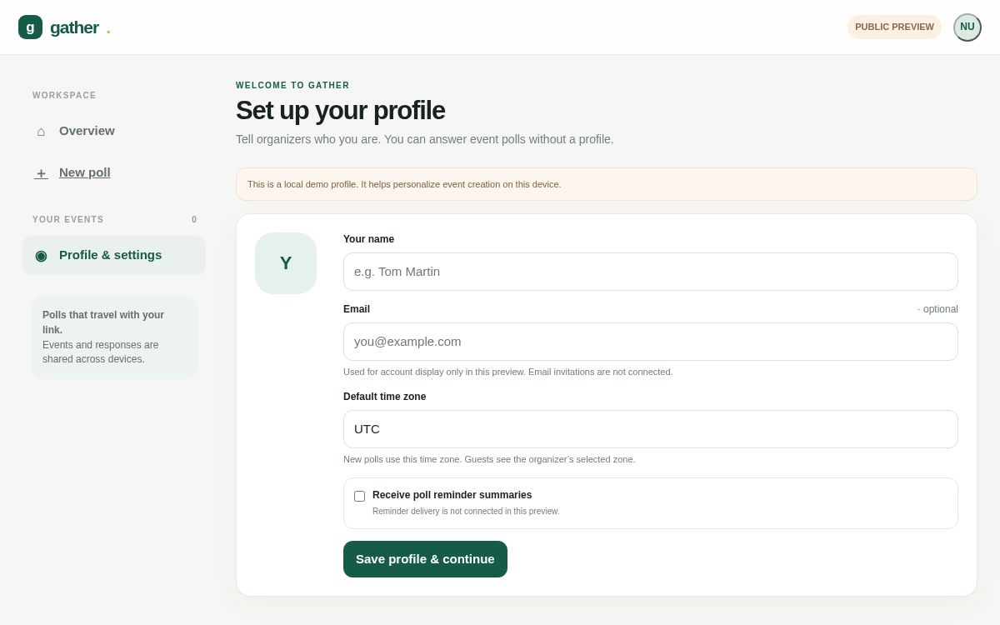
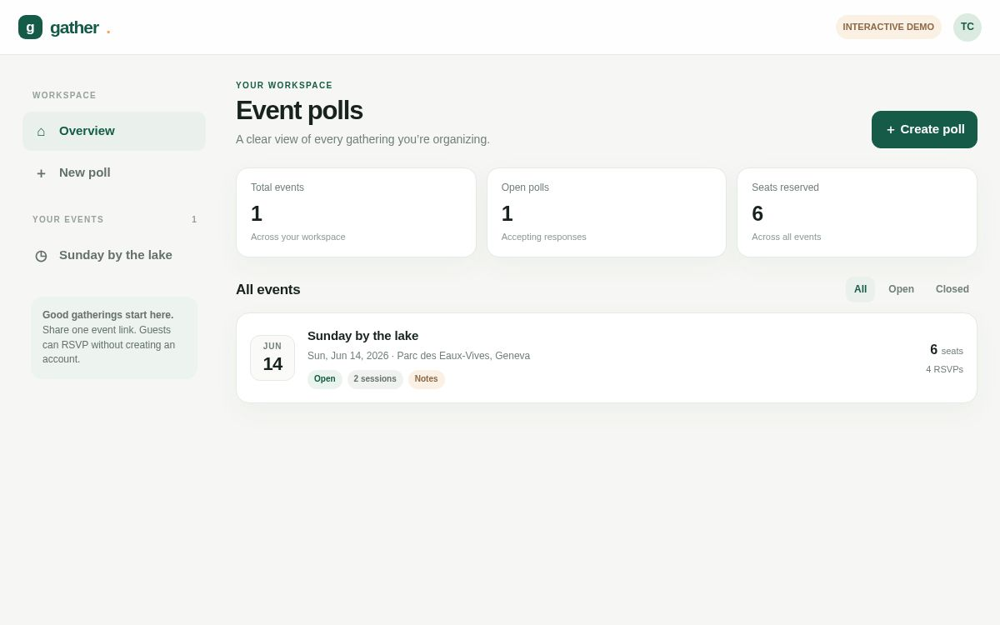

# Gather

A mobile-friendly event polling app for finding a time, organizing sessions, and collecting choices from a group. Share a poll link and participants can respond with their name without creating an account.

**[Open the live site](https://gather-event-polls.benclawbot.chatgpt.site/)**

## Screenshots

Current profile setup:



Organizer dashboard from the original interactive demo (the interface has since evolved):



## What it does

- Create polls for proposed dates and times, sub-events on a single day, or a list of text options.
- Let participants choose multiple options or set a maximum number of choices per response.
- Share an event-specific link, collect names and multiple-seat reservations, and receive notes visible to the organizer.
- Add per-option capacity, a response deadline, a location, a video link, and an optional event picture.
- View, edit, close, reopen, and delete events in the organizer dashboard; review and remove responses.
- Confirm a final time for a date poll and let guests download a calendar file.
- Hide the guest list when desired. Event and response records are stored centrally so shared links work across devices.

## Getting started

1. Open the [live site](https://gather-event-polls.benclawbot.chatgpt.site/) and set up an organizer profile.
2. Choose **New poll**, select a poll type, add options and settings, and create the event.
3. Share the participant link. Guests can respond without creating a profile.
4. Return to the dashboard to review responses and manage the event.

## How it is built

The interface is a responsive HTML, CSS, and JavaScript application in `src/index.html`. A Cloudflare Worker in `worker/index.js` serves the interface and API. Cloudflare D1 stores polls and responses; Cloudflare R2 stores event pictures. Schema migrations are in `drizzle/`.

The deployed version is hosted on ChatGPT Sites. Its tracked `.openai/hosting.json` identifies that particular Site and its storage bindings; use your own project and resources for a separate deployment. GitHub does not automatically deploy changes to the existing Site.

To build the Worker bundle locally with Node.js:

```sh
node scripts/build.mjs
```

The build writes `dist/server/index.js` and copies the hosting manifest. Running the full app requires a Worker-compatible environment with a D1 binding named `DB`, an R2 binding named `BUCKET`, and the migrations applied in order. The build script alone does not start a local server or provision storage.

## Current limitations

- Organizer profile information and the organizer access token are stored in the browser. They do not currently sync to another browser or device; clearing browser data can remove access to the organizer dashboard.
- Reminder settings are saved, but automatic reminder emails and invitation emails are not connected.
- Calendar integration provides an `.ics` download; it does not automatically send invitations or connect calendars.
- This is a public preview, not a production identity or account system.

## Project layout

| Path | Purpose |
| --- | --- |
| `src/index.html` | Application interface and client logic |
| `worker/index.js` | Worker and API |
| `drizzle/` | D1 schema migrations |
| `scripts/build.mjs` | Builds the deployable Worker |
| `.openai/hosting.json` | Existing Sites project and storage binding configuration |
